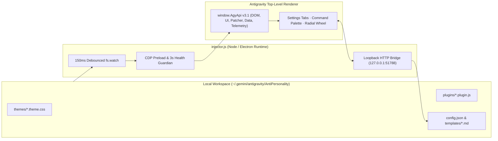

<div align="center">



<br />

[](https://github.com/killgame1234/AntiPersonality)
[](./LICENSE)
[](./plugin.json)
[](./PRIVACY.md)
[](#accessibility--privacy-guarantees)

<p>
  <strong>Unofficial luxury client-customization, View Transition theming, tactile WebAudio foley, modular plugins, and live AI Persona calibration suite for Google Antigravity Desktop.</strong>
</p>

<p>
  <a href="#quick-start">Quick Start</a> ·
  <a href="#whats-new-in-v31">What's New in v3.1</a> ·
  <a href="#living-themes">Themes</a> ·
  <a href="#modular-plugins">Plugins</a> ·
  <a href="#ai-personas">Personas</a> ·
  <a href="#keyboard-shortcuts">Shortcuts</a> ·
  <a href="#architecture">Architecture</a> ·
  <a href="#legal--non-affiliation">Legal</a>
</p>

</div>

---

## Why AntiPersonality?

Most client mods stop at swapping hex codes. **AntiPersonality v3.1** treats your coding environment like a high-craft instrument—combining Raycast-speed navigation, tactile physics, and live AI behavior tuning with **zero external npm dependencies** and **zero cloud telemetry**:

| Pillar | Experience |
| :--- | :--- |
| **Sensory & Tactile UI** | Spring-eased cards, specular borders, sliding sidebar pills, laser compile sweeps, subtle particle bursts, and warm `BiquadFilterNode` WebAudio foley. |
| **Living Atmospheric Themes** | Cursor-origin circular `startViewTransition` shockwaves, circadian/parallax ambient auras, procedural SVG film grain (`0` on Pure AMOLED), and streaming conic rims. |
| **Instant Power-User Flow** | Non-destructive live theme preview in the <kbd>Ctrl</kbd>+<kbd>Shift</kbd>+<kbd>M</kbd> Command Palette, <kbd>Alt</kbd>+<kbd>`</kbd> 6-slice Radial Quick-Wheel, and split Custom CSS live studio. |
| **Immortal Local Engine** | Survives <kbd>Ctrl</kbd>+<kbd>R</kbd> window reloads via top-frame-isolated CDP preload (`Page.addScriptToEvaluateOnNewDocument`) + 150ms debounced `fs.watch` hot-swap. |

---

## Quick Start

AntiPersonality runs directly on Antigravity's built-in Electron Node runtime—no separate Node.js or `npm install` needed.

```powershell
# 1. Clone into your Antigravity configuration directory
git clone https://github.com/killgame1234/AntiPersonality.git "$env:USERPROFILE\.gemini\antigravity\AntiPersonality"

# 2. Launch the persistent local bridge (:51788), reload guardian & hot-reload watcher
$env:ELECTRON_RUN_AS_NODE = "1"
& "$env:LOCALAPPDATA\Programs\antigravity\Antigravity.exe" "$env:USERPROFILE\.gemini\antigravity\AntiPersonality\injector.js" server
```

> [!TIP]
> Once running, open **Antigravity Settings** (look for the **AntiPersonality** section in the sidebar), press <kbd>Ctrl</kbd>+<kbd>Shift</kbd>+<kbd>M</kbd> for the Command Palette, or hold <kbd>Alt</kbd>+<kbd>`</kbd> anywhere to flick through themes and personas on the Radial Wheel.

---

## What's New in v3.1

- **Shockwave View Transitions**: Clicking any theme card expands a smooth circular `clip-path` shockwave directly from your cursor coordinates while cross-fading CSS tokens seamlessly.
- **Live-Preview Command Palette**: Arrow up/down through themes in <kbd>Ctrl</kbd>+<kbd>Shift</kbd>+<kbd>M</kbd> to preview full-window styling in real time; press <kbd>Enter</kbd> to commit or <kbd>Esc</kbd> to revert untouched.
- **6-Slice Radial Quick-Wheel (<kbd>Alt</kbd>+<kbd>`</kbd>)**: Hold <kbd>Alt</kbd>+<kbd>`</kbd>, aim your cursor toward one of 6 quick wedges (favorite themes, active persona cycle, Zen Mode, Custom CSS), and release.
- **Telemetry-Reactive Emblem & Foley**: `AgyApi.Telemetry` tracks live typing cadence (WPM) and streaming states—driving orbital speed on `CustomLogo` (<kbd>Alt</kbd>+Click for **Prism Overdrive**) and warm low-pass synthesized clicks in `AudioFX`.
- **Live Persona Specimen & Split CSS Studio**: Dragging the **Verbosity (0–100)** slider previews how the AI rewrites an answer in real time before atomically syncing (`fsync`) to `config.json`.

---

## Living Themes

All bundled `.theme.css` stylesheets contain **100% original CSS tokens and procedural SVG shaders** (zero copyrighted third-party images, videos, or font binaries). Every theme supports 1-click toggles for **Disable Background Video** and **Hide Floating Companions**.

| Theme | Palette | Signature Atmosphere |
| :--- | :--- | :--- |
| **Pure AMOLED Minimal** (`amoled`) |   | True `#000000` OLED pixel-off black, zero film grain (`--agy-grain-opacity: 0`), crisp emerald focus accents. |
| **The Black Shores** (`black-shores`) |    | Deep astral ocean slate, bioluminescent cyan & iris glassmorphism *(unofficial fan-inspired palette)*. |
| **Cyberpunk Capri** (`capri`) |    | High-contrast crimson & neon emerald HUD styling with telemetry-reactive ambient glow. |
| **Eldritch Void** (`eldritch`) |   | Abyssal obsidian canvas with crimson ocular highlights and subtle vignette depth. |
| **Moonlit Lotus** (`moonlit`) |    | Serene midnight pond tones paired with celestial ice-blue borders and warm gold highlights. |
| **The Prescripts** (`prescript`) |    | Monolithic dark terminal geometry with index-cyan & brass accents *(unofficial fan-inspired palette)*. |

---

## Modular Plugins

Toggle or hot-reload any of the **8 client-side plugins** independently from **Settings → Plugins** with automatic patch cleanup (`AgyApi.Patcher.unpatchAll`):

| Plugin | What It Adds | Controls |
| :--- | :--- | :--- |
| **`BetterCodeblocks`** | Sticky header bar, language badge, live line-number gutter, word-wrap, collapse, font zoom, and 1-click raw copy. | Inline codeblock toolbar |
| **`ImageUtilities & Zoom`** | Fullscreen lightbox with focal wheel zoom (`0.3x`–`8.0x`), pan, 90° rotate, flip, PNG clipboard copy, and Blob download. | Click any chat image |
| **`TokenCounter`** | Live `Prompt` / `Chat` / `Project` token & USD ledger with CJK-aware BPE estimation and model auto-detection. | Status pill in composer |
| **`PromptSnippets`** | 1-click workflow pills (`/plan`, `/test`, `/fix`, `/refactor`, `/compact`, `/boost`) supporting `{{clipboard}}` & `{{selection}}`. | Composer quick-bar |
| **`ZenMode`** | Multi-tier distraction-free studio focus that hides chrome without hijacking native Word Wrap (<kbd>Alt</kbd>+<kbd>Z</kbd>). | <kbd>Alt</kbd>+<kbd>Shift</kbd>+<kbd>Z</kbd> |
| **`AudioFX`** | Synthesized WebAudio chimes & warm `BiquadFilter` mechanical foley with live RMS meter—zero external audio files. | Settings toggle + volume |
| **`CompactMode`** | Three vertical rhythm presets (`Comfortable`, `Compact`, `Ultra-Dense`) for high-density pair programming. | Settings density selector |
| **`CustomLogo`** | WPM-reactive orbital emblem in the titlebar with theme-synced accents and hidden **Prism Overdrive**. | <kbd>Alt</kbd>+Click / Right-Click emblem |

---

## AI Personas

Switch your agent's engineering personality on the fly from **Settings → Personas** or the Command Palette:

| Archetype | ID | Signature Stance |
| :--- | :--- | :--- |
| **The Senior Tech Lead** | `tech-lead` | Pragmatic architecture, root-cause fixes, explicit trade-offs, zero fluff. |
| **The Patient Mentor** | `mentor` | Step-by-step mental models, clear analogies, and guided verification. |
| **The 10x Speedrunner** | `speedrunner` | Maximum velocity, direct diffs, minimal prose, immediate execution. |
| **The Paranoid SRE** | `sre-auditor` | Defensive boundaries, failure-mode analysis, idempotency, and rollback safety. |
| **The Zen Minimalist** | `minimalist` | Smallest complete diff, deletion over addition, calm single-screen replies. |

Each persona can be fine-tuned with **Verbosity (`0–100`)**, **Autonomy (`Supervised` / `Balanced` / `Autonomous`)**, and **Strict Typing**, persisted atomically to `config.json` and `.agents/personality.json`.

---

## Keyboard Shortcuts

| Shortcut / Command | Action |
| :--- | :--- |
| <kbd>Ctrl</kbd> + <kbd>Shift</kbd> + <kbd>M</kbd> | Open **Command Palette** (fuzzy search + live non-destructive theme preview) |
| <kbd>Alt</kbd> + <kbd>`</kbd> *(Backquote)* | Summon **6-Slice Radial Quick-Wheel** at cursor position |
| <kbd>Alt</kbd> + <kbd>Shift</kbd> + <kbd>Z</kbd> | Toggle **Zen Mode** focus layout |
| <kbd>Alt</kbd> + **Click** *(Top-left Emblem)* | Trigger **Prism Overdrive** on `CustomLogo` |
| `/ap` or `/antipersonality` | Slash command to open AntiPersonality Settings directly from chat |

---

## Architecture



<details>
<summary><strong>View Full Repository Layout & CLI Commands</strong></summary>

### Directory Structure

```text
AntiPersonality/
├── assets/
│   └── banner.svg              # Animated vector hero banner
├── core/
│   ├── agy_api.js              # window.AgyApi v3.1 (DOM, Modals/Toasts, Data Export/Import/Purge, Patcher, Telemetry)
│   ├── addon_manager.js        # Standardized @metadata docblock parser
│   ├── theme_manager.js        # Shockwave View Transitions, live preview/revert & atmospheric shaders
│   ├── plugin_manager.js       # Hot-swap plugin lifecycle, rollback & auto-unpatch
│   ├── settings_tab.js         # Native 4-tab Settings UI, Command Palette & Alt+Backquote Radial Wheel
│   └── bundle_runtime.js       # Top-frame-isolated, CSP-safe runtime bundler (no eval / new Function)
├── plugins/                    # 8 modular client-side extensions (*.plugin.js)
├── themes/                     # 6 original CSS-token & procedural-SVG stylesheets (*.theme.css)
├── templates/                  # 5 AI Persona archetype definitions (*.md)
├── rules/                      # Runtime persona enforcement rules (AGENTS.md)
├── skills/                     # Built-in Antigravity agent skills (theme-manager, ai-theme-maker, persona tools)
├── scripts/
│   └── verify_smoke.js         # 6-stage smoke, idempotency, WCAG & legal/privacy compliance suite
├── injector.js                 # Local CDP bootstrapper, Origin-allowlisted loopback bridge & fs.watch daemon
├── config.json                 # Active persona & calibration defaults
└── plugin.json                 # Antigravity plugin manifest
```

### CLI Reference

```powershell
$env:ELECTRON_RUN_AS_NODE = "1"
$app    = "$env:LOCALAPPDATA\Programs\antigravity\Antigravity.exe"
$script = "$env:USERPROFILE\.gemini\antigravity\AntiPersonality\injector.js"

& $app $script server          # Start persistent daemon (:51788), reload guardian & fs.watch hot-reload
& $app $script install         # One-shot bundle injection without persistent daemon
& $app $script open themes     # Open Settings tab (themes | plugins | personas | custom-css | palette)
& $app $script status          # Query live bridge, theme, plugin, and persona status
& $app $script reset           # Cleanly unpatch all plugins and restore stock Antigravity UI

# Run the 6-stage automated smoke, idempotency & compliance verification suite:
& $app "$env:USERPROFILE\.gemini\antigravity\AntiPersonality\scripts\verify_smoke.js"
```

</details>

---

## Accessibility & Privacy Guarantees

- **100% Local Loopback (`127.0.0.1`)**: Never binds to `0.0.0.0`, sets **zero cookies**, loads **zero external trackers or CDN scripts**, and enforces strict `Origin` allowlisting on `:51788`.
- **1-Click Right to Portability & Erasure**: Export your entire setup via **Export Config** (`AgyApi.Data.exportAll()`) or wipe every `agy_*` `localStorage` key in one click via **Purge Data** (`AgyApi.Data.purgeAll()`).
- **Keyboard & Motion Accessible**: Full `:focus-visible` keyboard rings across custom cards/controls and automatic `@media (prefers-reduced-motion: reduce)` support.

---

## Legal & Non-Affiliation

- **License**: Released under the [MIT License](./LICENSE) and provided `"AS IS"`, without warranty of any kind.
- **Policies**: Read [PRIVACY.md](./PRIVACY.md), [COOKIE_STORAGE_POLICY.md](./COOKIE_STORAGE_POLICY.md), [TERMS.md](./TERMS.md), and [SECURITY.md](./SECURITY.md).
- **Non-Affiliation**: AntiPersonality is an independent, unofficial community project and is **not affiliated with, endorsed by, or sponsored by Google LLC** (Google Antigravity), **Kuro Games**, or **Project Moon**. All product and studio names remain the property of their respective owners.
